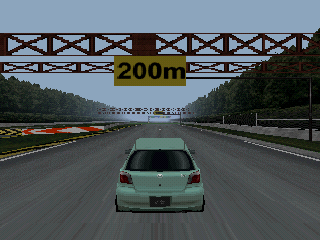
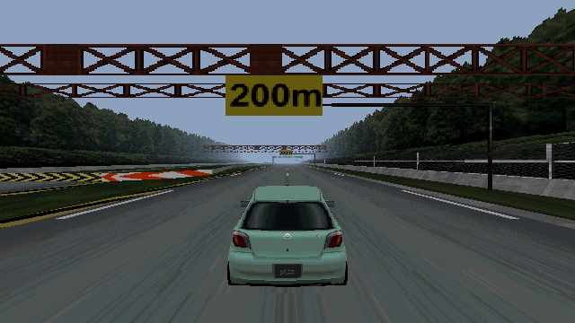
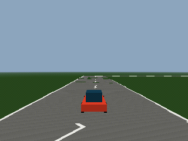

# Gran Turismo 2, native Rust port

A native Rust port of Gran Turismo 2 (PlayStation, USA Simulation Mode Rev 2),
built with [Bevy](https://bevyengine.org). The game runs as ordinary Bevy code
on top of a separate, reusable engine. Assets are exported locally from your
own disc; the native executable runs without an emulator or the psx toolkit.

| B-1, with the PS1 look (320×240) | Widescreen, with the PS1 look switches off (640×360) |
|---|---|
|  |  |

Both images are captures of the current port at the same reference pose.
The sky and ground are provisional, and the car is still static. These show
rendering and camera progress; a playable driving session remains unfinished.
See [how the screenshots were captured](docs/screenshots.md).

- **Separate engine and game.** `engine/` provides reusable formats, rendering,
  collision queries and registries. `game/` contains GT2's vehicle rules,
  course presentation and cameras. A desktop content editor is planned.
- **Mods are crates.** A mod can replace assets, reuse public controllers and
  disable or replace feature plugins. [The example mod](mods/example) renders
  a handmade course, car and wheels through the same renderer and camera rules:

  

- **Display and controls options.** F1 opens control rebinding; F2 opens display
  settings. Resolution, aspect ratio, fullscreen, vertex snapping, dithering
  and colour quantization are configurable.

## Status: a work in progress

The port is **not yet playable**. B-1 renders from imported course and vehicle
data, and much of the vehicle simulation has been checked against original
execution. Connecting those rules into a complete driving session is the next
milestone. Menus, licence outcomes, races and progression still need work.

| Area | Status |
|---|---|
| B-1 road, placed scenery and textures | Rendered from decoded assets; other primitive types, backgrounds and LOD remain |
| Road subdivision and texture detail | Match recorded splits, UVs and projected-area selections, including independent holdouts |
| Vitz body and procedural wheels | Imported and rendered at the reference pose; wheel animation, shadows and reflections remain |
| Bumper, near/far chase and rear-look cameras | Match original pose recordings; R1 cycles views, L1 looks back |
| Pedals, digital steering, wheel slip and braking | Rules checked against original execution; analog controls remain |
| Tyre forces, grip, engine, drivetrain and transmission | Individual stages and connected subsystem sequences verified; full feedback loop remains |
| Road contact, suspension, vertical motion and aerodynamics | Decoded collision and retained histories verified together; remaining force/control producers are being connected |
| Playable B-1 test, HUD, sounds and pass/fail/retry | Not yet complete |
| Other licences, races, opponents, menus, garage and saves | Not yet ported end to end |
| Example mod and engine sandbox | Run with handmade assets and no disc data |
| Desktop content editor | Planned |

[PORT_PLAN.md](PORT_PLAN.md) tracks the remaining scope.
[docs/evidence.md](docs/evidence.md) indexes the original observations,
recording commands, verification coverage and explicit gaps for each feature.
Race physics uses the observed 30 Hz cadence, with 60 Hz presentation.

## Built with psx

The port is made with [psx](https://github.com/bombpersons/psx), a PlayStation
reverse-engineering toolkit:

- It runs the original and records memory values, writes, input and instruction
  traces. Headless Bevy tests compare the port with those recordings, including
  fresh scenarios recorded after implementation.
- Its disassembler and Ghidra integration help trace each rule to the original
  routine. Evidence notes distinguish executed behaviour from binary analysis
  and describe what remains unverified.
- Its template supplies the PS1 rendering, input, tick scheduling, trajectory
  tests and developer MCP used to step and screenshot the native game.

The offline importers in this repository turn the player's disc data into
engine-native assets. **No runtime game assets, original reference fixtures,
disc images or BIOS files are distributed.** The README screenshots are
presentation images, not assets used to run the game.

## Running it

Requires Rust **1.97.1+**, Bevy **0.20.0** and a desktop GPU driver (or Mesa
lavapipe with `--software`). To render B-1, first export assets from your own
USA Simulation Mode Rev 2 disc and NTSC-U BIOS. The exporter needs an installed
`psx` CLI; it downloads neither tools nor media. See [asset setup](docs/assets.md).

```sh
python3 tools/export_assets.py /path/to/game.cue --bios /path/to/scph5501.bin
cargo run                              # current B-1 reference scene
cargo run -- --software                # software renderer
cargo run -p example-mod               # handmade example, no disc required
cargo run -p engine --example sandbox  # engine-only handmade scene
cargo test --workspace --all-features  # routine checks, including local recordings
cargo build --release                 # build without developer MCP
```

F11 toggles fullscreen. `--controls` and `--display` open their respective
menus on launch; `--aspect window` follows the window's shape. The
[template README](psx-bevy/README.md) documents all display, input and developer
options. For offscreen stepping and screenshots:

```sh
cargo run --features dev-mcp -- --mcp --headless --software
```

Without exported data, the engine, example mod and source-only tests still
build and run; tests needing private assets or recordings report as ignored.
Generated files stay in ignored `game/assets/`, `game/tests/data/original/`
and `.psx/`. CI audits the public Git history with
`python3 tools/check_public_repo.py --history`.

## Layout

| Path | Contents |
|---|---|
| `engine/` | Reusable formats, geometry/collision, object and action registries, tuning and sandbox ([guide](engine/AGENTS.md)) |
| `game/` | GT2 vehicle rules, course and car presentation, cameras and trajectory tests ([guide](game/AGENTS.md)) |
| `mods/example/` | A separate mod built from handmade assets using the game's public API ([README](mods/example/README.md)) |
| `psx-bevy/` | The psx template's rendering, ticks, input, menus, testing and developer MCP ([README](psx-bevy/README.md)) |
| `tools/import/` | Offline disc-format importers that write engine-native assets |
| `tools/` | Local asset exporter, original-recording scripts and verification tools |
| `docs/` | Evidence, engine model, asset setup and template edit notes |

Template updates use `psx template update --dry-run`, then
`psx template update`. Edited template files receive a sibling `.psx-new`;
[docs/template.md](docs/template.md) lists the local edits to reapply.
